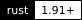
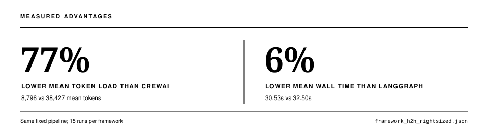
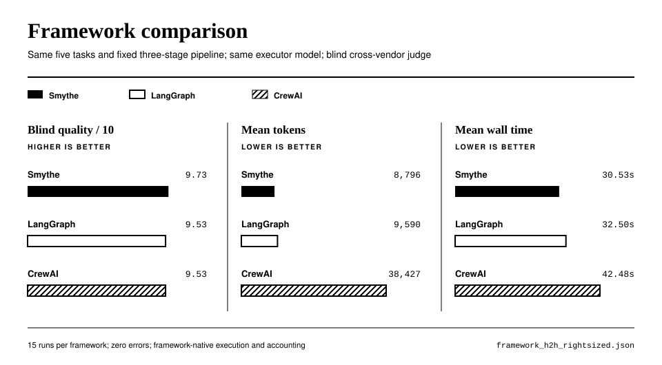
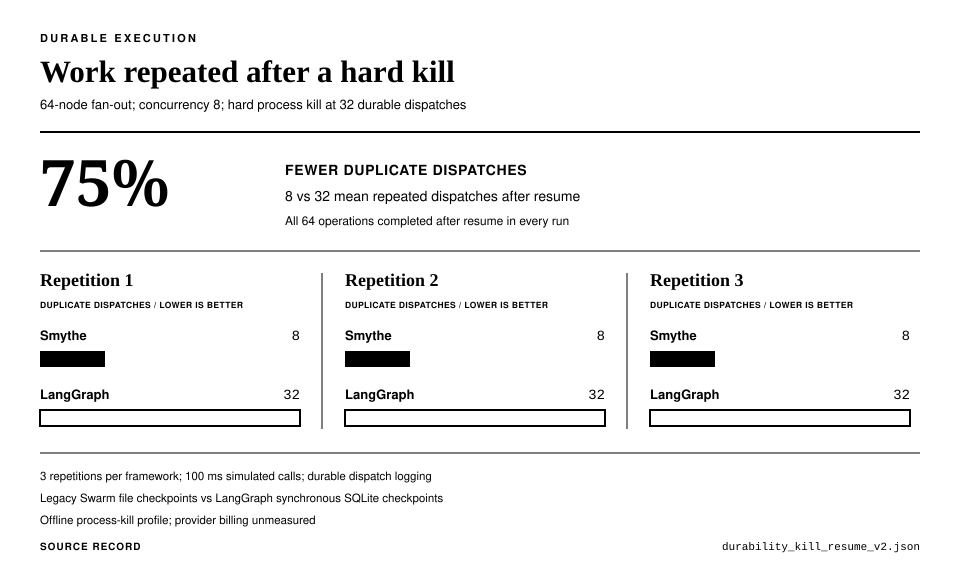
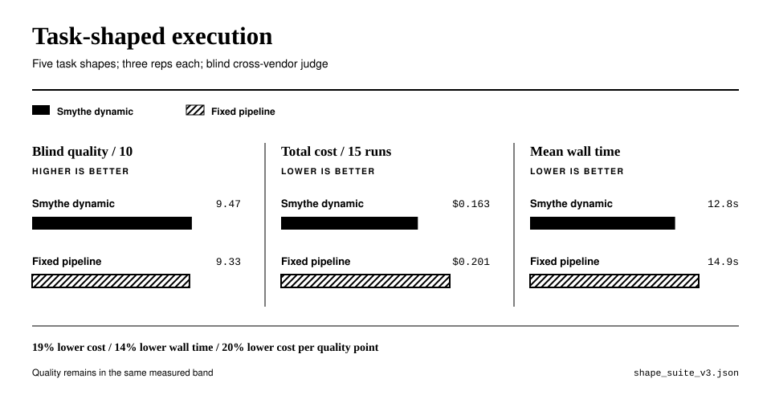
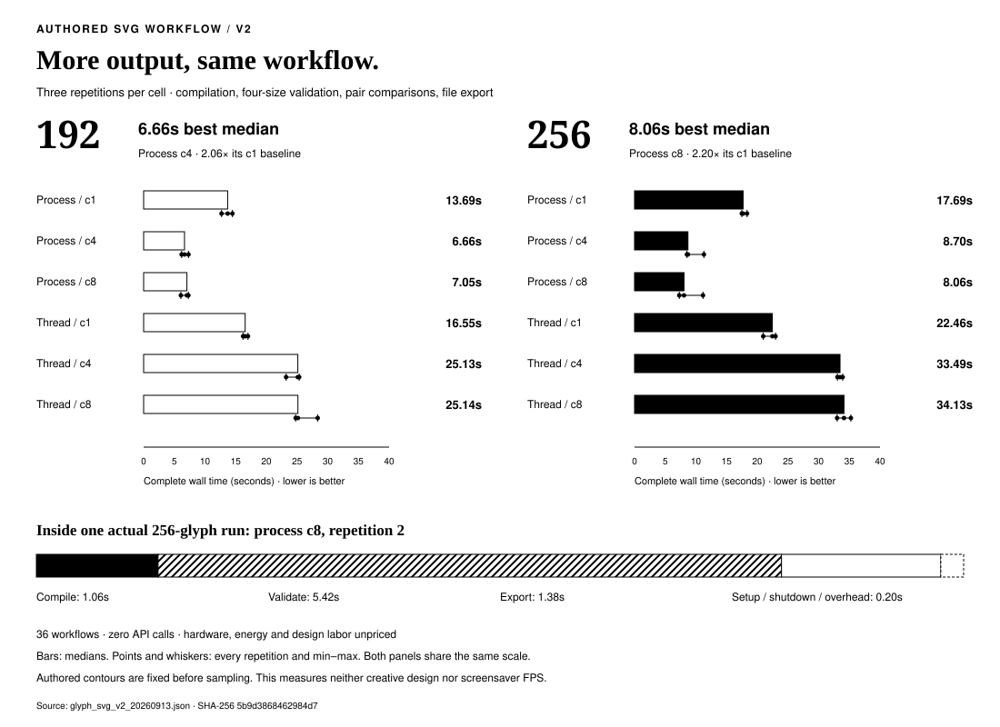
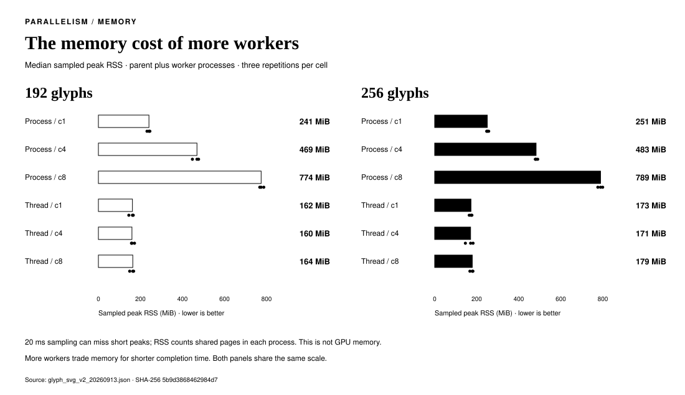
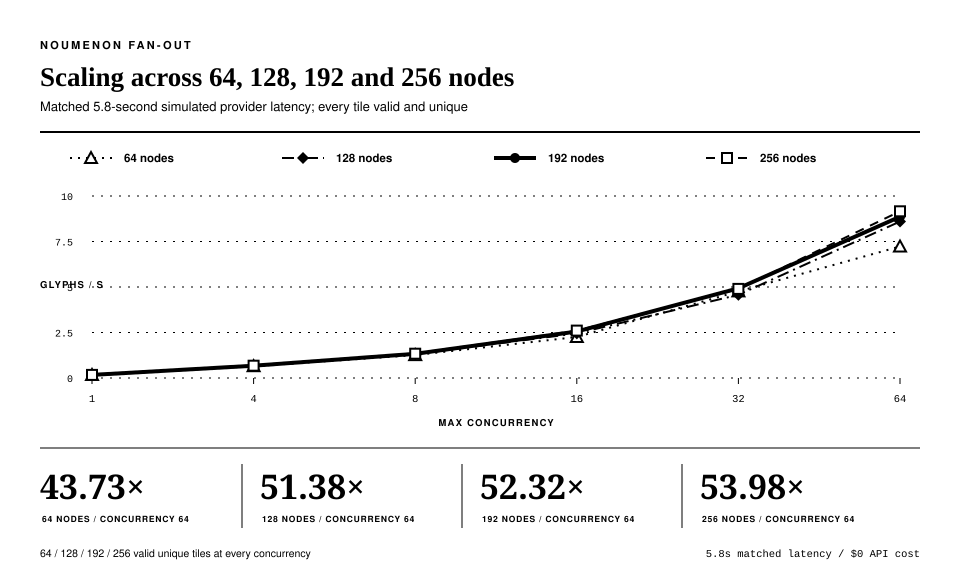
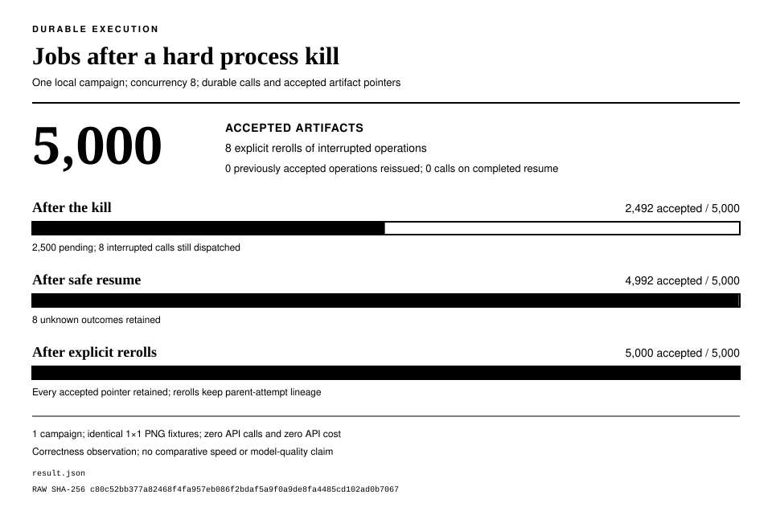

<div align="center">
  
  <p><em>An open-source framework for task-based agent swarms with dynamic parallelization, routing, and execution topology.</em></p>
  <p>
    <a href="docs/rust.md"></a>
    <a href="https://github.com/petehottelet/smythe/actions/workflows/rust.yml?query=branch%3Afeature%2Frust-noumenon+event%3Apush"></a>
    
    <a href="LICENSE"></a>
  </p>
  <p>
    <a href="#quickstart">Quickstart</a> ·
    <a href="#how-it-works">How it works</a> ·
    <a href="#measured-results">Measured results</a> ·
    <a href="docs/index.md">Documentation</a>
  </p>
</div>

**Smythe is a Rust framework for running task graphs with durable recovery.**
Define the work and its dependencies, execute ready tasks in parallel, and
inspect the journal of outputs and costs. The native engine combines bounded
concurrency, exact cost reservations, and recovery after a process interruption.

The **Rust 0.2.0 preview** runs local workflows and the Noumenon glyph
pipeline without Python or API keys. Model-driven planning, paid providers,
tools, and MCP are still part of the existing Python implementation; their Rust
ports are ahead. [Current scope](docs/rust.md).

<p align="center">
  
</p>
<p align="center"><em><a href="docs/rust.md#noumenon-acceptance">Noumenon</a> is Smythe's parallel-processing example: each glyph compiles as an independent task, and the Rust pipeline validates and exports the catalog.</em></p>

The native pipeline preserves the existing SVG artwork and names. It supports
up to **256 authored glyphs**, including the 192 shown above, checks them at
four raster sizes, and exports SVGs, a catalog, an atlas, and validation reports.
This is deterministic local work with **zero API calls**. The animation shows
the catalog in use; it is not a recording of a Rust execution or a timing result.

<p align="center">
  <a href="benchmarks/noumenon/catalog/contact-sheet-128.png">192-glyph sheet</a> ·
  <a href="benchmarks/partitions/glyph_svg_v2_256/catalog/contact-sheet-128.png">256-glyph sheet</a> ·
  <a href="benchmarks/noumenon/catalog/README.md">Individual SVGs</a> ·
  <a href="https://github.com/petehottelet/noumenon">Noumenon screensaver</a> ·
  <a href="docs/current-materials.md">All materials</a>
</p>

## Quickstart

Build from this checkout with **Rust 1.91 or later** and a C build toolchain
for bundled SQLite. The Rust packages are unpublished; the supported path is a
source build. Run these commands from the repository root:

```bash
cargo fetch --locked
cargo build --release --locked --offline -p smythe-cli
```

Once dependencies are fetched, the examples run offline. Using `cargo run`
selects the Rust executable even if the Python CLI is also on your PATH.

### Run, inspect, and resume a graph

The bundled [example graph](examples/native_graph.toml) contains two dependent
tasks: `research` followed by `summarize`. The local `OfflineProvider` returns
each task's goal, input, and references to dependency outputs, so you can inspect
execution and recovery without a model call.

```bash
cargo run --release --locked --offline --bin smythe -- run --graph examples/native_graph.toml --id example --store smythe_artifacts/native-runs
cargo run --release --locked --offline --bin smythe -- inspect example --store smythe_artifacts/native-runs --events
cargo run --release --locked --offline --bin smythe -- run --graph examples/native_graph.toml --id example --store smythe_artifacts/native-runs --resume
```

The first command executes both nodes and saves their results. `inspect` returns
the saved state and events as JSON. Resuming the completed run returns the same
outputs with `reused_nodes: 2`, `provider_calls: 0`, and `cost_nanousd: "0"`.
Use a new ID for another fresh run, or `--resume` to reopen the existing one.

Graphs can be TOML or JSON. Set `--workers` to bound parallel work and
`--budget-nanousd` to set the cost ceiling; their defaults are four workers and
zero. The bundled provider charges nothing.

### Generate the Noumenon catalog

```bash
cargo run --release --locked --offline --bin smythe -- noumenon --glyphs 256 --workers 8 --out smythe_artifacts/native-glyphs
cargo run --release --locked --offline --bin smythe -- noumenon --glyphs 256 --workers 8 --out smythe_artifacts/native-glyphs --resume
```

A fresh run requires a new output directory. Full mode compiles the glyphs,
renders at 16, 32, 64, and 128 pixels, checks topology and pairwise distinctness,
and writes SVGs, `catalog.json`, `validation.json`, `atlas.png`, and `report.json`.
Use `--mode compile` for compilation only. A completed resume validates the
saved exports and makes no new provider calls.

[Native commands and recovery](docs/rust.md) · [Examples](examples/README.md).

## How it works

**The graph defines the work.** Each node names a task and its dependencies.
Smythe validates the graph before execution and dispatches a ready child as
soon as its dependencies are accepted. Independent tasks share a bounded worker
pool; an unrelated slow sibling does not hold up a ready branch. The Rust alpha
executes graphs you supply. Generating a task-specific topology from a goal
remains on the Rust roadmap.

**The execution envelope governs the run.** A single coordinator owns
admissions, cost reservations, and state transitions. It records dispatch intent,
stores outputs as immutable hashed blobs, and journals receipts and settlement
in SQLite. Recovery can reuse recorded results and complete pending settlement;
interrupted local work without a saved result may run again.

| You need to… | The Rust alpha provides |
|---|---|
| Define the workflow | Validated TOML or JSON graphs with explicit dependencies |
| Bound parallel work | Readiness-driven execution through a bounded Rayon worker pool |
| Account for cost | Checked integer nanoUSD, reservations before dispatch, and idempotent settlement; current providers are local and zero-cost |
| Recover interrupted work | SQLite journals, immutable output blobs, and integrity checks before reuse |
| Inspect or control a run | JSON results, saved events, and persisted pause, continue, and stop commands |
| Produce the glyph catalog | Authored SVG compilation, raster validation, distinctness checks, and resumable exports |
| Embed the engine | The `smythe` crate's `Swarm`, local `Provider` contract, store, and tracing types |

Pause and stop prevent new admissions while active local calls drain. Recovery
guarantees cover local process crashes. Remote effects, distributed workers,
and power-loss guarantees are outside this alpha's scope.

The current native journal uses schema 2; older alpha runs require a new
directory. Resume checks semantic compatibility and saved outputs, so unrelated
source edits do not invalidate a run. See the [recovery contract](docs/rust.md#journal-and-recovery).

[Scheduling and accounting](docs/rust.md#workspace-and-scheduling) ·
[Journal and run controls](docs/rust.md#journal-and-recovery) ·
[Glyph acceptance](docs/rust.md#noumenon-acceptance).

## Measured results

**The journaled Rust alpha has no claimable performance headline yet.** The
retained Rust/Python comparison measures the earlier native preview. Its
compilation clock excludes durability work now performed by the shared engine,
so those timings do not describe this implementation.

| Evidence | What it establishes | Scope |
|---|---|---|
| [Original Rust preview comparison](benchmarks/rust_noumenon_results.md) | Matching SVG bytes across Rust and both Python backends; independent validation of native catalogs | Historical diagnostic preview; different full-workflow clocks do not establish an end-to-end speedup |
| [Native measurement guide](docs/rust.md#verification-and-native-measurements) | How to record fresh CLI runs with source and binary provenance | Diagnostic runner for the journaled engine; CPU and peak-memory measurements are still pending |
| [Python benchmark collection](benchmarks/README.md) | Recorded framework, topology, artifact, and recovery results | Evidence for the Python implementation, within each report's stated limits |

The Python [SVG workflow](benchmarks/svg_v2_results.md),
[Noumenon fan-out](benchmarks/noumenon_benchmark.md),
[interruption study](benchmarks/durability_benchmark.md), and
[Astra/Sol findings](benchmarks/astra_findings.md) remain available with their
protocols and records. They are not Rust performance claims.

## Historical Python benchmark results

The following measurements and charts describe the Python implementation.
They remain scoped to their linked protocols and are not Rust performance claims.

### Framework efficiency

On a fixed three-stage pipeline, Smythe used **77% fewer tokens and 28% less
wall time than CrewAI** across five tasks and three repetitions per framework,
with the same executor model and blind cross-vendor judging. It also recorded
6% less mean wall time than LangGraph, and the highest observed quality score:
9.73/10, versus 9.53 for both. Token counts describe model usage, not invoice
savings.

<p align="center">
  
</p>

<p align="center">
  
</p>

### Recovery after interruption

After a hard kill, Smythe repeated **8 calls versus LangGraph's 32**, a 75%
reduction, in each of three matched repetitions. Both finished all 64
operations. [Recovery protocol](benchmarks/durability_benchmark.md).

<p align="center">
  
</p>

### Generated execution topology

Across five task shapes, generated plans took **14% less wall time than a fixed
pipeline, planning included**. They used one node for a simple transformation
and 5.3 on average for parallel research. Observed quality averaged 9.47/10
versus 9.33/10, within measured judge variation.
[Task-shape protocol and records](benchmarks/shape_suite.md).

<p align="center">
  
</p>

The [200-workflow Astra/Sol study](benchmarks/astra_findings.md)
also reports the limits of generated plans: they increased mean time in both
models on its ten synthetic tasks. The frozen rule accepted 191/200 workflows;
human review accepted all eight disputed available answers. One missing usage
receipt limits affected exact cost comparisons. All outcomes remain published.

### Parallel artifact generation

Smythe compiles, validates at four sizes, compares every pair, and exports
**256 SVG glyphs in 8.06 seconds median**, **2.20× faster** than its
concurrency-one baseline with eight process workers. All 36 workflows pass with
identical SVG and pixel hashes across repetitions, with zero API calls.
[Results and scope](benchmarks/svg_v2_results.md).

<p align="center">
  
</p>

Process workers trade more memory for shorter completion time:

<p align="center">
  
</p>

At concurrency 64, generating 192 glyphs took **21.7 seconds** versus 1,133.3
seconds serially, **52.3× faster**, and all 192 validated as unique. This is a
controlled offline measurement with 5.8 seconds of simulated provider latency
per call; every 64-, 128-, 192- and 256-node run produced complete sets of
valid, unique tiles. [Noumenon protocol and records](benchmarks/noumenon_benchmark.md).

<p align="center">
  
</p>

Live GPT Image lanes generated the same 192 glyphs as transparent PNGs, and
traced them into SVGs, three calls at a time within the account's image rate
limit. [Live lanes](benchmarks/noumenon_benchmark.md#live-image-lanes).

### Jobs at 5,000 operations

A durable Jobs campaign was killed mid-run and recovered to **5,000 accepted
artifacts**. Safe resume preserved the 2,492 outputs already accepted and
reissued none of them; eight interrupted operations needed explicit rerolls,
and resuming the completed job made zero new calls. One offline campaign with
identical fixtures, so this shows recovery correctness, not speed.
[Results and independent reconciliation](benchmarks/jobs_scale_5000_20260907_results.md).

<p align="center">
  
</p>

[All benchmarks, charts, and evidence status](benchmarks/README.md).

## Project status

**Rust workspace: 0.2.0, source preview.** APIs and journal formats are
experimental. The workspace contains `smythe-core` for graph and accounting
contracts, `smythe` for the shared runtime, `smythe-cli` for the executable,
`smythe-noumenon` for the glyph pipeline, and `xtask` for native measurements.
Rust CI covers Linux and Windows.

Native development focuses on measurement and testability, followed by
remote accounting, provider integrations, tools, planning, supervision, and
Jobs. See the [roadmap](ROADMAP.md#rust-alpha-020).

The **Python 0.10 line** remains in the repository during the transition. Its
[quickstart](docs/python-quickstart.md), [examples](examples/README.md#python-examples),
and [release guide](docs/release-0.10.0.md) describe capabilities that have not
all been ported. Rust runs do not require a Python installation.

The [Noumenon screensaver](https://github.com/petehottelet/noumenon) is a separate
project that renders the glyph catalog. Smythe's native command produces the
catalog; it does not build or run the screensaver.

[Documentation](docs/index.md) · [Native development checks](docs/rust.md#verification-and-native-measurements) ·
[Contributing](CONTRIBUTING.md) · [Changelog](CHANGELOG.md) ·
[Security](SECURITY.md) · [MIT license](LICENSE).
