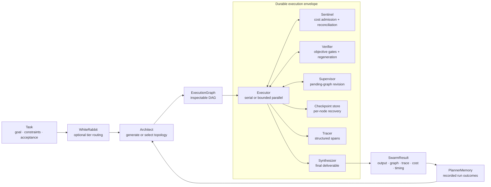

# Architecture

Smythe is organized around two core abstractions: a generated execution graph
and the durable envelope that governs its execution.

## System at a glance



## 1. Generated execution topology

`Task` captures the goal, constraints, context, and acceptance criteria. An
Architect converts it into an `ExecutionGraph`: a validated DAG whose nodes
name concrete work products, dependencies, capabilities, failure policies,
timeouts, and optional verification relationships. Graphs you write in Python
or YAML can also set per-node models and agent tools; generated plans cannot.

Applications can inspect, reject, edit, export, or execute the graph. Planning
never implies execution.

The graph carries a detached `Task` snapshot, preserving source context and
acceptance criteria through inspection, execution, supervision, synthesis,
memory, and resume. [Task handoff semantics](tasks.md).

### Planning tiers

| Tier | Class | Decision surface |
|---|---|---|
| Single worker | `SimpleArchitect` | One node does the whole task |
| Deterministic | `DeterministicArchitect` | Python constructs the exact graph |
| Constrained | `ConstrainedArchitect` | A model selects from approved `SubGraphTemplate` values |
| Autonomous | `LLMArchitect` | A model generates a task-specific graph |

`WhiteRabbit` can route tasks between those tiers, first by the
[routing rules](#routing-rules) a developer gives it, then by a classifier
whose reply it matches without regard to case or surrounding punctuation. The
registry then assigns nodes to agents by required capabilities, including
capabilities hydrated from external skill inventories.

**Changed in 0.8.1:** model output is data. `LLMArchitect` reads a generated
plan under a strict schema (`smythe.loader.build_graph_from_model_output`): a
plan cannot declare MCP servers, commands, URLs, environment variables, or
per-node models, and unknown fields are rejected. Node ids are 1–64 letters,
digits, `-` or `_`; plans are limited to 8 nodes and 5 levels by default
(`LLMArchitect(max_nodes=..., max_depth=...)`), and a node may ask for at most 3
retries and 2 regenerations. A reply that breaks the schema, or that stops at
the output token limit, is retried with the problem named, up to `max_retries`.

**Changed in 0.8.2:** a generated plan may contain at most one gating node,
which must list the node it verifies in `depends_on`, and a generated node
timeout must be at least 60 seconds (`smythe.loader.MODEL_PLAN_MIN_TIMEOUT_S`),
because a timeout cancels provider calls that were already sent. A planning
reply that the provider refused or filtered is retried like a truncated one
([stop reasons](execution.md)). No graph, generated or written by hand, may use
the node id `__synthesis__`, which the synthesizer reserves for its budget and
trace entries.

`ConstrainedArchitect` limits the composed graph to 64 nodes by default
(`ConstrainedArchitect(max_nodes=...)`) and retries a selection over the limit.
It copies its template list when constructed, so later changes to the caller's
list do not change its menu, and it rejects duplicate template names with
`ValueError`. Template builders receive model-chosen `params` and must bound
them: the limit is checked when each builder call returns. In a durable run,
the LLM and constrained architects also check each plan against the run's graph
policy, plain-text node rules and journal node-id rule before planning is saved
([durable planning](workflow-accounting.md#freeze-graph-limits)). A durable
run's template builders must return the same nodes, with the same ids, for the
same task and params: resume rebuilds each saved selection, and a repair prompt
can name a node id, so a builder that relies on `Node`'s random default id can
make resume fail with `WorkflowConflictError`.

### Routing rules

`WhiteRabbit(rules=[...])` applies developer-written `RoutingRule` values
before any classifier call. They are evaluated in order on the submitted
`Task` snapshot, and the first that matches chooses its tier, so a stable
transformation can take the single-worker path and a familiar or separable
task an approved template without a classification call:

```python
from smythe import RoutingRule, SimpleArchitect, WhiteRabbit

router = WhiteRabbit(
    single=SimpleArchitect(),
    deterministic={"weekly-report": report_architect},
    constrained=template_architect,
    autonomous=llm_architect,
    rules=[
        RoutingRule("stable-transform", "single", "a stable transformation needs one worker",
                    goal_any=("translate", "reformat"), max_constraints=2),
        RoutingRule("familiar-report", "deterministic:weekly-report",
                    "the weekly report has a fixed shape", goal_any=("weekly report",)),
        RoutingRule("separable-chapters", "constrained",
                    "each chapter can be edited in parallel from a template",
                    min_items=("chapters", 3)),
    ],
)
```

A rule matches when every condition it sets holds; a rule without conditions
matches every task.

| Condition | Holds when |
|---|---|
| `goal_any` | the goal contains any of these phrases, ignoring case |
| `goal_none` | the goal contains none of these phrases, ignoring case |
| `context_keys` | each key is a top-level key of `Task.context` |
| `min_items=(key, n)` | `Task.context[key]` is a list or object with at least `n` items |
| `max_constraints` | the task lists at most this many constraints |
| `max_done_when` | the task lists at most this many acceptance criteria |

A rule's `tier` names a configured tier as a routing decision records it:
`single`, `deterministic:<key>` with the key as configured, `constrained` or
`autonomous`. A tier the router does not configure, duplicate rule names, or
a value other than a `RoutingRule` (subclasses included) raises `ValueError`
when the router is built. When no rule matches, routing continues as before:
the classifier chooses, and without one the autonomous tier plans.
`RoutingRule.matches(task)` evaluates a single rule.

Rules are developer configuration, never Task or plan data. They read only
the goal, constraints, context keys and sizes, and acceptance criteria of the
frozen Task snapshot, never model output, and nothing in `Task.context` can
add, change or skip a rule.

`single` is a first-class single-worker tier, such as `SimpleArchitect`,
which plans one node for the whole task. The classifier is offered it as
`single` only when it is configured, so a router without it sends the same
classifier prompt as before. Under a
[retry policy](execution.md#retry-policy), its provider is checked with every
other tier's before any call.

A router with rules or a single tier records `policy_version` 2 in its
decisions: rules in order, then the classifier, else the autonomous tier.
Other routers record 1. A durable run's recipe adds the router's `single`,
`rules` and `routing_policy_version` only when they are configured, so other
recipes keep their bytes. Resume compares them exactly: a run resumed with
other rules, another single tier or another policy version raises
`WorkflowConflictError` before any call, and a run that has planned replays
its saved decision without evaluating rules again. New runs can therefore
return to an earlier routing policy without changing the recipes of runs
already in progress.

### Routing decisions

`WhiteRabbit.decide(task)` and `adecide(task)` return the chosen architect
with a `RoutingDecision` that records the choice; `route()` and `aroute()`
still return only the architect. The record holds:

- `tier`: `single`, `deterministic:<key>`, `constrained` or `autonomous`, one
  of the `alternatives` the router offers;
- `method`: `rule` when a [routing rule](#routing-rules) chose the tier,
  `classifier` when the reply named a configured tier,
  `fallback_no_classifier` without a classifier, or `fallback_unmatched` when
  the reply named none; both fallbacks choose `autonomous`;
- `matched_token`: the reply as normalized and matched, such as
  `deterministic:faq`, for the `classifier` method only. The raw reply is
  never recorded;
- `reasons`, which explain the choice (for a rule, its name and its own
  `reason`), and `policy_version`, the version of the routing policy that
  made it;
- `usage`: the classifier call's tokens, reported `cost_usd` and its
  `cost_usd_is_estimate` and `cost_usd_unknown` flags as booleans, or `null`
  without a call. A cost or flag the provider's result omits records as
  `null` or `false`;
- `call_ids`: in a durable run, the journal calls of its `routing` phase,
  which hold the classifier's charge, in place of `usage`.

A `Swarm` with a `WhiteRabbit` router stores `decision.to_dict()` as
`graph.planning["routing"]`. `ExecutionGraph.planning` holds informational
records keyed by namespace, and each component writes only its own key, so an
architect may record others beside it; it is `None` when nothing recorded any,
and it never enters node metadata. The record holds no elapsed time:
[`SwarmResult.timing`](execution.md#timing) reports routing time under
`phases_ms.routing`. An ordinary run records the classifier's usage without
charging it to the run's budget, whose scope stays execution and synthesis.
Checkpoints keep the record, and resume restores it
([graph planning records](checkpoint-format.md#graph-planning-records)).

In a durable run, the `planning` operation's result carries the decision under
`routing` as well as in its saved graph. Resuming restores the whole
`graph.planning` from the saved graph without classifying again; a run planned
before these records existed restores `None`. A router other than
`WhiteRabbit`, or a subclass that overrides `route()` or `aroute()`, is called
as before and records nothing. The record changes neither the classifier's
prompt nor a durable recipe; only [rules and a single tier](#routing-rules)
do.

### Topology vocabulary

- **Serial** for dependent stages.
- **Fork-join** for independent specialist work that must be combined.
- **Broadcast-reduce** for many variants produced from a shared brief.
- **Adversarial** for work that needs a challenge or audit before delivery.

The planning prompt starts from one node and requires each added node to
contribute a distinct work product. That right-sizing policy is what lets the
same system use one node for a transformation and a wide graph for parallel
artifact generation.

**Added in 0.8.0:** `LLMArchitect(planning_instructions="...")` keeps graph-policy
instructions in the planning request and saved recipe. Answer requirements
remain in `Task.constraints`, which reaches every executor.
[Bounded planning example](workflow-accounting.md#freeze-graph-limits).

## 2. Durable execution envelope

The graph runs through one set of controls regardless of who designed it.

| Component | Responsibility |
|---|---|
| `Executor` / `AsyncExecutor` | Dependency scheduling, failure policies, retries, timeouts, and bounded parallelism |
| `Sentinel` | Validate usage, reserve cost before dispatch, reconcile completed calls, and stop new work at the ceiling |
| `Tracer` | Record node lifecycle, tool use, revisions, regenerations, and cost metadata |
| `CheckpointStore` | Persist graph, results, agents, task, control counters, and spend for resume |
| `Supervisor` | Review completed results and revise only the unexecuted remainder |
| `Verifier` | Judge a target node and reset its downstream subtree after a failed gate |
| `Synthesizer` | Return the graph's intended deliverable rather than its execution transcript |

### Execution flow

1. Validate the DAG and stamp its model and task context.
2. Admit ready nodes up to `max_concurrency`.
3. Reserve each node's worst-case or estimated cost before provider dispatch.
4. Execute provider and MCP tool calls under node and loop timeouts.
5. Persist results and cost at the configured checkpoint interval.
6. Apply bounded verification or supervision decisions.
7. Synthesize the deliverable and write the terminal checkpoint.

Both executors stop new work on a terminal failure. The parallel executor also
cancels and awaits active siblings. Completed results and charges remain
available to an explicit resume. See [Execution policies](execution.md).
Verification records pending decisions and regeneration intents before
cancelling affected work. Those control checkpoints bypass node batching;
resume completes them before dispatch or cached-output return.
See [Verification](verifier.md#recovery-and-concurrent-work).

## Artifacts and jobs

Provider responses can include artifacts as well as text. Each execution
writes artifact bytes atomically into its own directory under `artifact_dir`
and records each file's absolute path, MIME type, SHA-256 digest and size in
the node's metadata. Under a
[strict acceptance policy](verifier.md#strict-delivery-acceptance), a
regenerated node's files are named for its generation and never replace an
existing file, so a rejected generation's files keep the bytes that were
judged. That publication links each file into place, so it needs a filesystem
with hard links: on one without them, such as FAT or exFAT, the node fails
with an `OSError` that says so; choose an `artifact_dir` on a filesystem with
hard links, such as NTFS, APFS or ext4. Nodes can receive dependency images as
native vision inputs. A node reads each image from its path when it calls, and
an image whose bytes no longer match the digest in its record raises
`ArtifactIntegrityError` before the call rather than reaching the model.
`OpenAIImageProvider` does not accept image inputs yet, so it raises
`ValueError` for a request with attachments instead of generating without them.

The Jobs surface adds a manifest and operator protocol for high-fan-out work:
complete worst-case preflight, approval bound to the exact plan and ceiling,
SQLite attempt/event journaling, explicit unknown outcomes, selective rerolls,
and portable exports. See [Jobs](jobs.md).

## Tools and skills

Agents can carry MCP server specifications. The runtime discovers an allowed
tool set, runs a bounded tool loop, traces every call, and resolves secret
environment variables at execution time without serializing their values.
Servers come only from developer configuration: Python, YAML, or the templates
you write. A generated plan cannot declare one, and resuming a checkpoint
written before 0.8.1 drops its servers. See [MCP](mcp.md).

Capability hydration influences assignment; MCP tools enable execution. The
Architect receives the effective agent/tool inventory so it can design the
graph around capabilities that actually exist.

## Learning loop

`PlannerMemory` records the task, topology, cost, summed node time, elapsed
time, and outcome of each completed run and recalls relevant outcomes into
later planning prompts. Its `total_duration_ms` field sums recorded spans;
overlapping nodes contribute their individual durations, so this value is not
elapsed wall time. Each attempt records its own span, including retries,
regenerated work and an `LLM_MERGE` synthesis call; a node's recorded duration
is that of its final attempt.

`elapsed_ms` is the elapsed time of the call that recorded the run, from
[`SwarmResult.timing`](execution.md#timing). A resumed run records only the
resuming call's spans and elapsed time, with `resumed` true and
`latency_complete` false. Each record also keeps the result's
`cost_is_complete` and `cost_contains_estimates` flags, and `acceptance` is
the decision of a [strict acceptance policy](verifier.md#strict-delivery-acceptance),
or `not_evaluated` for a run without one. Records written
before these fields existed recall with them `null`, meaning not recorded, and
recall skips rows where they are malformed. Planner prompts still show only the
summed node time.

**Added in 0.8.0:** recalled topology, success, cost, and duration fields
are validated before ranking. Malformed records are skipped without rewriting
the history file; valid values, legacy keys, and relevance ordering remain
unchanged. Planner prompts label the recorded duration as “Summed node time.”

`distill_template` turns a successful completed graph into a reusable
`SubGraphTemplate`, moving a proven topology from autonomous planning into the
constrained tier. The template keeps the graph's dependency edges,
verification gates, and node failure policies, retries, and timeouts; results,
costs, and statuses stay behind. The template is an in-memory object that you
pass to `ConstrainedArchitect`; `PlannerMemory` does not store templates.

This keeps learning reviewable: execution history informs future choices, and
promoted graph structure becomes an explicit template rather than an invisible
prompt mutation.

## Public boundaries

- The graph is the planning and inspection boundary.
- Nodes carry retries, timeouts, traces, and cost records. Node results and
  verification control transitions form the checkpoint boundaries.
- Without `run_store`, the ordinary Swarm budget governs execution and synthesis;
  model-based routing, planning, and successful supervision remain outside it.
- With `run_store=SQLiteWorkflowStore(...)`, supported text workflows on the
  native Responses or Claude Messages provider, or a stateless
  `OfflineProvider`, share one durable ledger across routing, planning,
  execution, verification, supervision, and synthesis. Request-bound quotes,
  fenced dispatch, and retained response evidence govern admission and
  recovery. See [managed scope](workflow-accounting.md#supported-scope).
- With `context_sources`, such a run records the context each node call is
  given as an immutable snapshot in its journal: sources and dependency
  outputs reach the model as marked untrusted data, a resumed call is given
  the snapshot it was first given, and new sources enter a run only through
  `refresh_context`, which re-evaluates its nodes. See
  [context snapshots](tasks.md#context-snapshots).
- A supervisor may change only pending work. It cannot drop a verification
  gate or the node it judges, or leave the gate no longer depending on that
  node; a step it adds after that node is not judged by the gate. One
  `LLMSupervisor` revision may add at most `max_added_nodes` nodes (default 3),
  and a proposal that would leave more than `max_total_added_nodes` (default 8)
  revision-added nodes in the graph is refused. Under a strict acceptance
  policy, so is a revision that would leave the delivered output without a
  check that can accept it ([acceptance obligations](verifier.md#acceptance-obligations)).
- A strict acceptance policy refuses, before any provider call, a graph whose
  delivered output it could not decide, and counts a passed gate toward
  acceptance only when the developer supplied it.
- A verifier may reset only its target and downstream dependents.
- A resumed run keeps completed results, recorded spend, and consumed control allowances.

The [cost guardrails](budgets.md) reject malformed usage and block unresolved
accounting on resume. Managed accounting does
not expand the supported text-workflow boundary to tools, attachments, or
arbitrary paid custom components; those retain their separate documented scopes.
